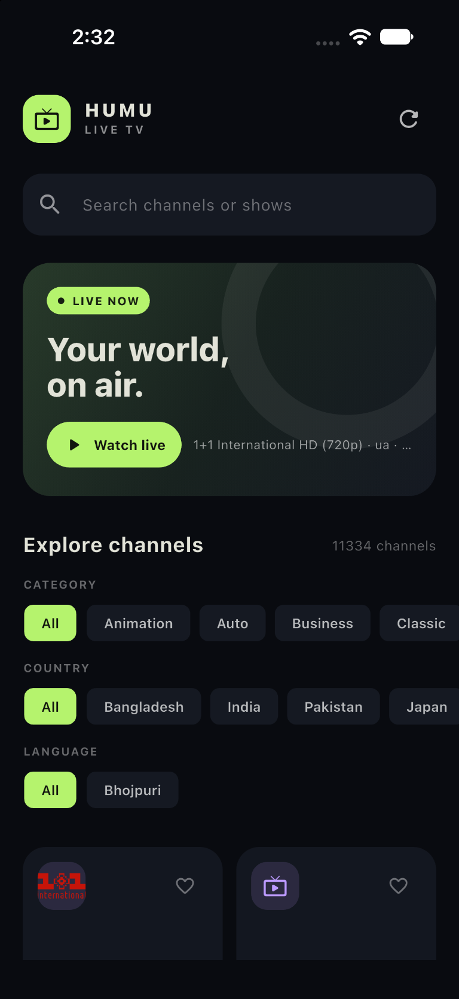
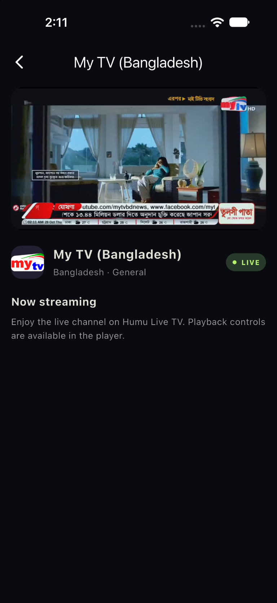
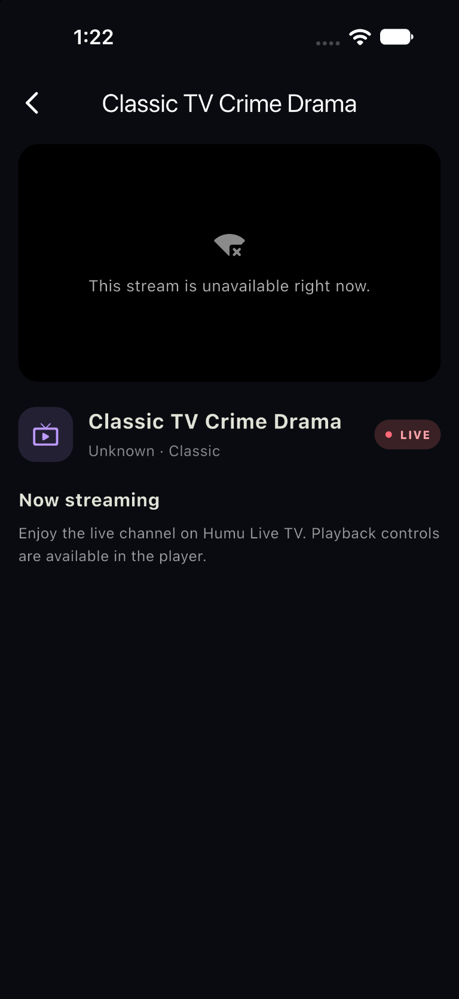

# Humu Live TV

A Flutter app for browsing and playing live TV channels from a public M3U
playlist. It supports channel search, country/category/language filters,
favorites, channel logos, and HLS playback.

## Screenshots

| Home screen | Channel playback | Unavailable stream |
| --- | --- | --- |
|  |  |  |

The unavailable-stream screenshot is an earlier capture; the current player
shows an **OFFLINE** status and a retry action when playback fails.

## Features

- Loads channels from the IPTV-org public playlist.
- Parses channel names, stream URLs, logos, countries, and categories from M3U
  metadata.
- Detects Bhojpuri channels and provides a language filter.
- Searches channels and filters by country, category, or language.
- Offers a clear-filters action when the current filter combination has no
  matching channels.
- Saves favorite channels on the device.
- Opens HLS streams in a player with playback controls.
- Hides channels after playback fails and remembers them on the device.
- Provides a refresh action to clear hidden-channel marks and retry channels.
- Shows playlist and playback errors with retry actions.
- Displays channel logos when available and uses a category icon as a fallback.

## Getting started

Requirements: Flutter and Dart versions allowed by `pubspec.yaml`.

```sh
flutter pub get
flutter run
```

Run the test suite and static analyzer:

```sh
flutter test
flutter analyze
```

## How channel loading works

The app fetches:

`https://iptv-org.github.io/iptv/index.m3u`

Each `#EXTINF` entry is parsed for `tvg-name`, `tvg-logo`, `tvg-country`,
`tvg-id`, `tvg-language`, and `group-title`. Country may be inferred from the
country suffix in `tvg-id` when `tvg-country` is missing. Bhojpuri is detected
from the channel name or language metadata.

The playlist is community-maintained. A channel appearing in it does **not**
guarantee that its stream is currently online, playable in every region, or
authorized for redistribution. Playback failures may also be caused by a
temporary network issue. Failed channels stay hidden until the user refreshes
the playlist or retries the channel.

Use only streams you are authorized to access and distribute. The app does not
bypass DRM, authentication, subscription, or regional restrictions.

## Project structure

```text
lib/
  data/
    channel_repository.dart       # Fetches the M3U playlist and maps channels
    m3u_playlist_parser.dart      # Parses M3U metadata and stream URLs
  models/
    channel.dart                  # Channel data model
  providers/
    favorites_provider.dart       # Persistent favorites state
    unavailable_channels_provider.dart # Persistent failed-channel state
  screens/
    home_screen.dart              # Search, filters, channel list
    player_screen.dart            # HLS playback and error/retry UI
  widgets/
    channel_logo.dart             # Logo with category-icon fallback
test/
  m3u_playlist_parser_test.dart
  unavailable_channels_provider_test.dart
  widget_test.dart
docs/
  screenshots/
```

## Dependencies

- `flutter_riverpod` for app state
- `http` for fetching the playlist
- `video_player` and `chewie` for stream playback
- `shared_preferences` for favorites and unavailable-channel state
